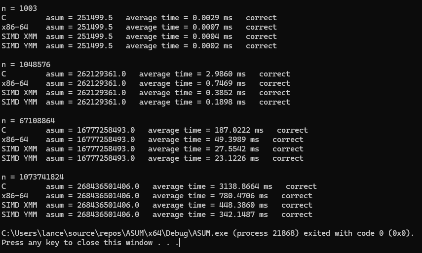
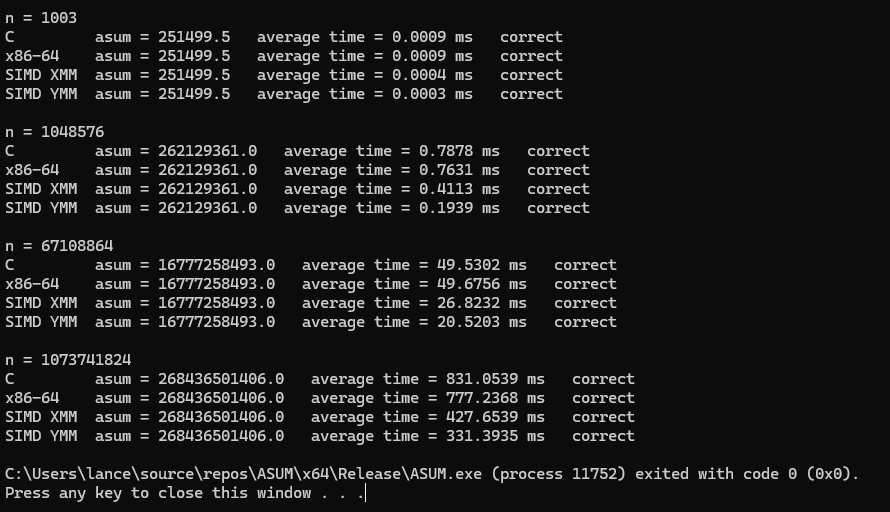
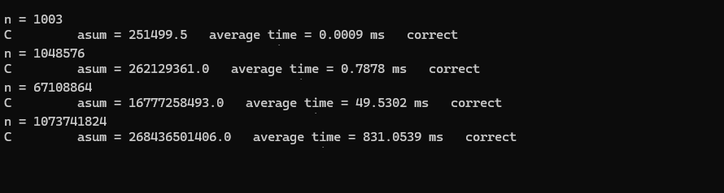
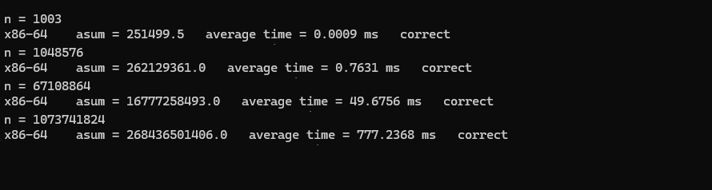
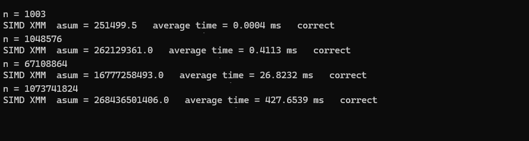
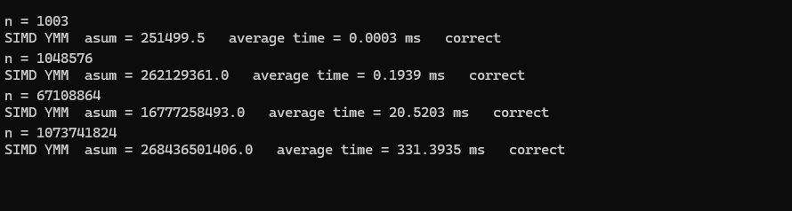
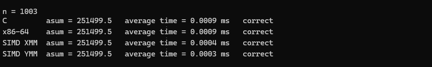

# ASUM: Sum of Absolute Values in C, x86-64 and AVX2 (XMM/YMM)

This project computes `asum = |A[0]| + |A[1]| + ... + |A[n-1]|` for a vector `A` of double-precision floats, using four kernels:

| Kernel | Language | Elements per step |
| --- | --- | --- |
| C | C (`main.c`) | 1 |
| x86-64 | x86-64 assembly, non-SIMD (`asum_x64.asm`) | 1 |
| SIMD XMM | AVX2 assembly, 128-bit XMM registers (`asum_xmm.asm`) | 2 |
| SIMD YMM | AVX2 assembly, 256-bit YMM registers (`asum_ymm.asm`) | 4 |

**Test machine:** AMD Ryzen 5 5600G (3.90 GHz), 16 GB RAM, Windows, Visual Studio 2026, NASM.

**Data:** every vector is initialized with

```c
A[i] = (i % 1000) - 500.5;
```

The values run from -500.5 to 498.5, mixing positive and negative numbers. Every value and every partial sum is a multiple of 0.5 and stays far below 2^53, so a double stores all of them exactly. Because of this, all four kernels give bit-identical results even though they add the numbers in a different order, and the correctness check can use `==` instead of a tolerance.

**Method:** each kernel runs 30 times per vector size. Only the kernel call is timed, with `QueryPerformanceCounter` before and after each call, and the 30 times are averaged. The sizes are n = 2^20, 2^26 and 2^30 (the full 2^30, an 8 GB vector), plus n = 1003 for the boundary check.

## i. Program output with execution times

**Debug**



**Release**



## ii. Execution time comparison

Average time per run in milliseconds (30 runs each):

| n | Build | C | x86-64 | SIMD XMM | SIMD YMM |
| --- | --- | --- | --- | --- | --- |
| 1003 | Debug | 0.0029 | 0.0007 | 0.0004 | 0.0002 |
| 1003 | Release | 0.0009 | 0.0009 | 0.0004 | 0.0003 |
| 2^20 | Debug | 2.9860 | 0.7469 | 0.3852 | 0.1898 |
| 2^20 | Release | 0.7878 | 0.7631 | 0.4113 | 0.1939 |
| 2^26 | Debug | 187.0222 | 49.3989 | 27.5542 | 23.1226 |
| 2^26 | Release | 49.5302 | 49.6756 | 26.8232 | 20.5203 |
| 2^30 | Debug | 3138.8664 | 780.4706 | 448.3860 | 342.1487 |
| 2^30 | Release | 831.0539 | 777.2368 | 427.6539 | 331.3935 |

Speedup over the optimized (Release) C kernel:

| n | x86-64 | SIMD XMM | SIMD YMM | YMM over XMM |
| --- | --- | --- | --- | --- |
| 2^20 | 1.03× | 1.92× | 4.06× | 2.12× |
| 2^26 | 1.00× | 1.85× | 2.41× | 1.31× |
| 2^30 | 1.07× | 1.94× | 2.51× | 1.29× |

Release time per element and the memory bandwidth each kernel reaches (8 bytes read per element):

| n | C | x86-64 | SIMD XMM | SIMD YMM |
| --- | --- | --- | --- | --- |
| 2^20 | 0.75 ns (10.6 GB/s) | 0.73 ns (11.0 GB/s) | 0.39 ns (20.4 GB/s) | 0.19 ns (43.3 GB/s) |
| 2^26 | 0.74 ns (10.8 GB/s) | 0.74 ns (10.8 GB/s) | 0.40 ns (20.0 GB/s) | 0.31 ns (26.2 GB/s) |
| 2^30 | 0.77 ns (10.3 GB/s) | 0.72 ns (11.1 GB/s) | 0.40 ns (20.1 GB/s) | 0.31 ns (25.9 GB/s) |

**Why each kernel is faster:**

- **Optimized C and x86-64 are tied (1.00–1.07×).** Both add one element at a time. MSVC's default floating-point mode keeps additions in the exact order written, so it cannot turn the loop into SIMD code. Its Release loop is essentially the same scalar loop as `asum_x64`.
- **SIMD XMM is about 1.9× faster.** Each `vaddpd` adds 2 doubles at once, so it needs half as many additions as the scalar kernels.
- **SIMD YMM is 4.06× faster at 2^20 but only about 2.5× at 2^26 and 2^30.** Each `vaddpd` adds 4 doubles at once. At 2^20 the 8 MB vector fits in the 5600G's 16 MB L3 cache and YMM reaches the full 4×. At 2^26 and 2^30 the data must come from RAM, and YMM stops at about 26 GB/s.

The 4.06× at 2^20 is slightly above the theoretical 4× only because the C run was a little slower than the x86-64 run; compared with the x86-64 kernel, YMM is 3.94× faster.

## iii. Correctness check: C

C is the answer key. Every kernel's result is compared with the C result using `==`. Cropped from the Release output:



## iv. Correctness check: x86-64



## v. Correctness check: SIMD XMM



## vi. Correctness check: SIMD YMM



## vii. Boundary check: SIMD XMM and SIMD YMM

n = 1003 is not a multiple of the SIMD width. For XMM, 1003 = 501 × 2 + **1**, so 1 element is left over. For YMM, 1003 = 250 × 4 + **3**, so 3 are left over. Both SIMD kernels still match the C answer:



The SIMD loops count down by 2 (XMM) or 4 (YMM) while at least that many elements remain. Subtracting multiples of 2 or 4 never changes the counter's lowest bits, so afterwards `test ecx, 1` (XMM) and `and ecx, 3` (YMM) give the number of leftover elements. The leftovers are added one at a time with an 8-byte `vmovsd` load, so the kernels never read past the end of the array.

## viii. Analysis

**YMM is the fastest kernel at every size, and optimized C and non-SIMD x86-64 are the slowest.**

**Is ASUM memory-bound or compute-bound?** It depends on the kernel:

- **C, x86-64 and XMM are limited by addition latency, not memory.** Each kernel keeps one running sum, so every addition must wait for the previous one to finish, about 3 clock cycles on this Zen 3 CPU. That gives about 0.7 ns per addition. The scalar kernels add 1 element per addition (about 0.74 ns per element) and XMM adds 2 (about 0.40 ns per element). These times stay the same from 2^20 to 2^30, which shows they don't depend on where the data is.
- **YMM is memory-bound once the data leaves the cache.** It adds 4 elements per addition, about 0.19 ns per element. That is what it achieves at 2^20, where the data is in the L3 cache. At 2^26 and 2^30 it slows to 0.31 ns per element, about 26 GB/s, because RAM can't deliver data any faster to one core. The 5600G officially supports up to dual-channel DDR4-3200, a theoretical peak of 51.2 GB/s, but a single core reaches only part of that.

ASUM does one addition for every 8 bytes it reads, so a kernel that adds fast enough always ends up waiting for memory. Here, only the YMM kernel is fast enough to reach that limit.

**Will SIMD YMM be faster than optimized C?** Yes: 2.51× faster at 2^30 and 4.06× at 2^20.

**Why the speedup is not the theoretical 2× and 4×:** XMM comes close to 2× (1.85–1.94×), because XMM is never fast enough to be limited by memory. YMM reaches 4× only while the data fits in the cache. With large vectors, it spends most of its time waiting for RAM, so going from XMM to YMM adds only 1.29–1.31× instead of 2×. Wider registers make the arithmetic faster, but they don't make memory faster.

**Debug vs Release:** the C kernel is about 3.8× slower in Debug at 2^20, 2^26 and 2^30 (3138.87 ms vs 831.05 ms at 2^30), because unoptimized code keeps the sum and loop counter in memory instead of in registers. The assembly kernels take about the same time in both builds, because NASM assembles them the same way either way and the C compiler's optimization settings don't touch them. That's why Debug makes SIMD look 8–16× faster than C, while the fair comparison against optimized C is 2–4×.

**n = 1003:** these times (0.0002–0.0009 ms) are only a few timer ticks long, so they mostly measure timing overhead and are not used in the comparison.

## ix. Problems encountered, solutions and AHA moments

**Methods used**

- **Exact test data.** Different kernels add in different orders, which normally changes the last digits of a floating-point sum. Choosing values that are multiples of 0.5 keeps every sum exact, so `==` is a valid correctness check.
- **Absolute value with a mask.** A double's sign is its top bit. ANDing with `0x7FFFFFFFFFFFFFFF` clears it, which is how MSVC compiles `fabs`. In the SIMD loops, `vandpd reg, mask, [rdx]` loads the data and removes the sign in one instruction.
- **Reduction.** The YMM kernel combines its 4 partial sums with `vextractf128` (moves the upper half down), `vaddpd`, then `vhaddpd`. `vhaddpd` alone only adds within each 128-bit half, so the extract is needed.
- **Registers.** The kernels use only RCX, RDX and XMM/YMM 0–2, which are all volatile, so nothing has to be saved. `n` is an `int`, so only ECX is used.
- **Memory.** Each vector is freed before the next size is allocated, so the program needs 8 GB at its peak instead of about 8.5 GB.

**AHA moments**

- **Wider SIMD is not automatically faster.** Going from XMM to YMM gave 2.12× when the data was in the cache, but only about 1.3× when it came from RAM.
- **The scalar kernels are limited by waiting for the previous addition, not by memory.** Their speed doesn't change between 2^20 and 2^30.
- **Debug timings are misleading for C.** Only the C kernel changes between Debug and Release, so performance should be compared on Release.

## x. AI Declaration

AI assistance was used in the formatting and writing of the README file. All code was written and tested by human hands.